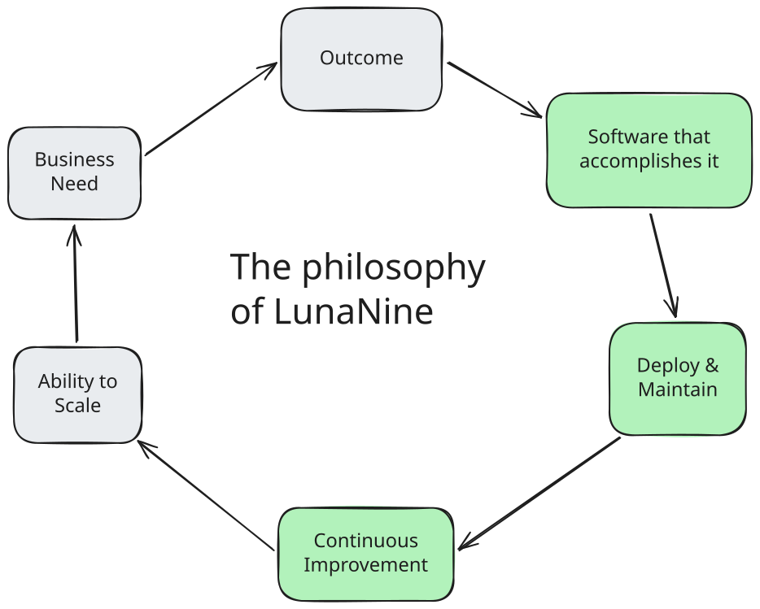
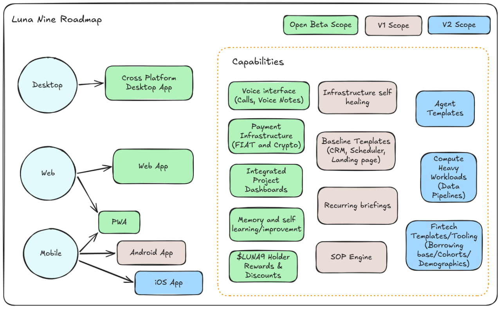

# LunaNine

An evolving site builder you can talk to.

**LunaNine is an evolving site builder you can talk to. It plans, builds, ships, and maintains your site.**

***It is easy to use, fast to ship, and reliable after launch.***

#### It's now an app on your phone, with a voice interface. 

## What LunaNine Does

Builds, deploys, and maintains the software tooling you need in your business,
tailored specifically to your processes and workflows.

It lets you turn your intuition and processes into automations, handle payments, and enable you to scale revenue and free up time. 

## Built For

Solo business owners or operators who need to scale revenue without scaling headcount. 

These operators are looking into better tools and automations. But no one serves their niche or the software is geared for large teams. 
The large players have no incentive to cater to this market, but we do. 

### By the numbers

27.2M US businesses are run by one person: 9.3M meaningful operators (≥$25k receipts) → 3.3M digital operators

**TAM ~$5.6B, SAM ~$2B (US, bottoms-up - Census NES, SBA)**

## Our Roadmap

### Timeline

- Open Beta: now live. 
- v1 Release: November/December
- v2 Release: Q1 2027

## Pricing Model

**A starter plan: $20 per month, $200 per year (10x monthly).**
Up to 3 projects and 1 domain. Client payments cost 8% (5% platform + 3% Stripe).

**An entry level plan: $30 per month, $300 per year (10x monthly).**
You start a site in a message.
Up to 5 projects and 3 domains. Sales and background checks are on this plan.

For additional usage we will have a top up model with "Booster Packs". 

These add additional inference capacity, i.e. more usage. We predict these will only be required during heavy buildout phases, enabling businesses to keep the abse rate for when they need only their upkeep, hosting, and normal pace of building and improving tools.

## LunaNine vs Competition

**Everyone sells the build. Nobody owns the loop.**

| | Builds | Deploys | Maintains | Solo-priced | Voice |
|---|---|---|---|---|---|
| Lovable · Bolt · Base44 | ✓ | partial | ✗ | ✓ | ✗ |
| Cursor · Claude Code | ✓ (you) | ✗ (you) | ✗ (you) | ✓ | ✗ |
| Devin | ✓ | partial | partial | ✗ | ✗ |
| Agencies | ✓ | ✓ | ✗ | ✗ | ✗ |
| **LunaNine** | **✓** | **✓** | **✓** | **✓** | **✓** |

No other coding agent even considers what you build as infrastructure. LunaNine understands the outcome is not software per se, it's systems. Software is just the medium to express and use the systems. 

## How we accomplish safety and effectiveness

We strive to provide stable and reliable tools, an agent that does what it needs to do, and to leverage the non deterministic nature of agents where it can shine, while maximizing what deterministic automation can do. 

Judgment and choice where it is needed, robustness everywhere. 

We follow these principles:

- **Control:** customer approves plans and actions; built for user control
- **Identity:** the agent works as a least-privilege bot, follows security principles
- **Alignment:** requirements are always confirmed and clarified

## Why voice first

Letting a stream of consciousness come out in a voice message can lead us to realizations about our objective or desired outcome.

A site is started in a message. 

We could talk about the technology being ready and scalable but the truth is, voice matters more than we give it credit for. 

By focusing on outcomes and asking questions where needed, LunaNine helps the user find clarity and delivers results. 

## How is the token integrated

We launched with the $LUNA9 token and have been blessed to have a community rally around us, supporting, and providing invaluable feedback. 

The token and web3 will be deeply integrated into LunaNine. 

**Token holders get:** 

- Exclusive custom themes for desktop, web, and PWA. 
- Discounts on Booster Packs
- Free usage for large holders of $LUNA9

*Exact threshold is to be determined.*

**Planned after open beta**

- $LUNA9 token based authentication for web3 native operators
- Payments in $LUNA9

## Get Access

Waitlist is live at [lunanineai.com](https://lunanineai.com).
